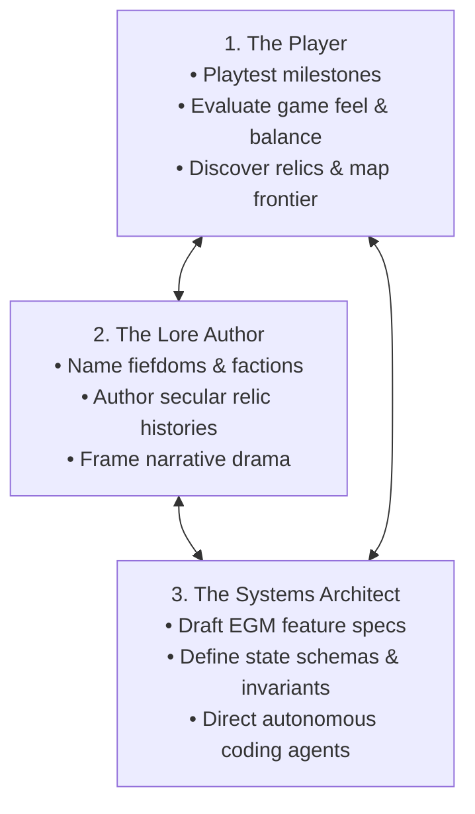

# The Emergent Experiment: A Pitch for Collaborator-Player-Developers

> [!NOTE]
> This document is an invitation for collaborators, playtesters, and software architects who want to co-create an experimental browser RPG through human-agent pair engineering.

---

## What is `emergent`?

`emergent` is a far-future, humanistic sandbox browser RPG set on a remote frontier world emerging from a semi-feudal dark age. Agrarian baronies, timber villages, and scavenger orders live in the literal shadow of colossal, weathered megastructures left behind by forgotten cosmic civilisations.

More than a game, `emergent` is an active experiment in **human-agent collaborative software engineering**. It bridges two worlds:
1. **A Living Sandbox Simulation:** Built from discrete, deterministic tick systems where complex systemic behaviours emerge naturally from simple, local rules.
2. **An Autonomous Development Testbed:** Engineered iteratively using **Google EGM (Elephant-Goldfish Model)**, where human developers provide architectural steering and creative authority, while autonomous AI coding agents implement and verify headless simulation systems.

---

## The Concept of the "Collaborator-Player-Developer"

Traditional game development separates the studio from the player: developers build behind closed doors, and players passively consume the end product.

`emergent` dissolves that boundary. We invite you to engage across three simultaneous dimensions:

* **As a Player:** You jump into playable milestone builds, traverse the grid, test inventory constraints, and evaluate pacing, responsiveness, and atmospheric "game feel".
* **As a Lore Author:** You preserve narrative sovereignty. AI agents are strictly forbidden from hallucinating major world lore; every barony, relic history, and character motivation originates from human contributors via asynchronous authoring canvases.
* **As a Developer / Architect:** You do not drown in boilerplate. You act as an engineering director: defining state schemas and invariants in living specifications (`docs/designs/`), subjecting them to zero-context adversarial AI reviews, and steering autonomous coding loops.

---

## The Core Worldbuilding Pillars

* **Humanistic Feudalism:** Grounded mortal drama, oaths of fealty, water disputes, caravan trade, and hard labour. People care about crop yields, honour, and lineage.
* **Deep Time & Secular Relics:** Ancient technology is not magical fantasy. It is incomprehensibly advanced physics, material science, and orbital engineering worn down by eons of weather, dust, and rust.
* **The "Emergent" Canopy:** In forestry, *emergents* are giant trees that pierce the high rainforest canopy. In our world, solitary ancient titan hulls puncture pastoral fields and wooded hills.
* **The Echo of Emergency:** Derived from the Latin *emergere* ("to rise out of depth"), it shares its root with *emergency*. Survival on the frontier is precarious, and ancient automated remnants do not always sleep quietly.

---

## The Engineering Philosophy

We reject fragile, hallucinated "AI code dumps" in favour of strict, spec-driven discipline:

1. **Google EGM (Spec-Driven Development):**
   * **The Elephant (Deep Context):** High-context agents interview human architects and draft comprehensive technical specifications before a single line of code is written.
   * **The Goldfish (Zero Context):** Swarms of isolated subagents review specifications with a blank slate, actively probing for edge-case failures, numeric drift, and unstated assumptions.
2. **Headless Deterministic Simulation (`engine/`):**
   * The simulation core is an authoritative, pure reducer state machine (`step(state, action): SimulationResult`).
   * Time advances strictly by discrete ticks.
   * 100% decoupled from graphics, audio, or browsers, and verified by pure unit test suites and action-fuzzing harnesses.
3. **Human Narrative Sovereignty:**
   * AI agents must never invent major world lore, factions, or premises autonomously.
   * All worldbuilding is posed as open questions to human contributors in [`docs/lore/open_questions.md`](file:///Users/efsa/Repos/emergent/docs/lore/open_questions.md).
4. **Atomic Checkpoint Commits:**
   * Autonomous agents only commit clean, passing state implementations when 100% of unit tests pass or when formal design specifications are approved.

---

## Current Roadmap & State

* **Milestone 1 Core Engine:** Fully implemented and verified in [`engine/`](file:///Users/efsa/Repos/emergent/engine) with 24 passing deterministic unit tests (cardinal movement, boundary clamping, LIFO inventory stacking, and relic conservation fuzzing).
* **Active Milestone:** Establishing continuous verification harnesses and browser presentation layers ([`client/`](file:///Users/efsa/Repos/emergent/client)).
* **Living Task Board:** Tracked transparently in [`TASKS.md`](file:///Users/efsa/Repos/emergent/TASKS.md) using Guido's autonomy tags: `[AUTO]`, `[SEMI]`, and `[HUMAN]`.

---

## How You Can Contribute Today

1. **Author In-Game Lore:**
   * Open [`docs/lore/open_questions.md`](file:///Users/efsa/Repos/emergent/docs/lore/open_questions.md) and flesh out player personas, regional baronies, or relic descriptions.
2. **Propose a Feature Specification:**
   * Use [`docs/designs/TEMPLATE.md`](file:///Users/efsa/Repos/emergent/docs/designs/TEMPLATE.md) to draft a new gameplay mechanic (e.g. weather systems, baronial trade barter, stamina/exhaustion, relic analysis).
3. **Run & Verify the Headless Engine:**
   * Clone the repository, run `npm install` and `npm test` inside [`engine/`](file:///Users/efsa/Repos/emergent/engine), and run deterministic fuzzing against state invariants.
4. **Build Presentation or Tooling:**
   * Contribute to the PixiJS/Canvas presentation client in [`client/`](file:///Users/efsa/Repos/emergent/client) or continuous verification scripts in [`scripts/`](file:///Users/efsa/Repos/emergent/scripts).

---

## Getting Started

* Read the live task board: [`TASKS.md`](file:///Users/efsa/Repos/emergent/TASKS.md)
* Review our agent engineering constraints: [`AGENTS.md`](file:///Users/efsa/Repos/emergent/AGENTS.md)
* Read the approved Milestone 1 specification: [`docs/designs/001_core_game_loop.md`](file:///Users/efsa/Repos/emergent/docs/designs/001_core_game_loop.md)
* Explore open world lore questions: [`docs/lore/open_questions.md`](file:///Users/efsa/Repos/emergent/docs/lore/open_questions.md)
