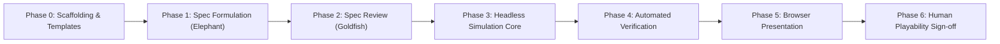

# Working Tasks List: emergent

> [!NOTE]
> This document is the authoritative, living task board for `emergent`. It is updated continuously by the autonomous driving agent to track active milestones, dependencies, requirements clarifications, and automated verification gates.

---

## Operational Status

* **Orchestrator Model:** Gemini Flash (strictly enforced unless manually overridden)
* **Quota Guardrails:** Cease autonomous development if rolling 5-hour limit < 20% or weekly limit < 30%
* **Current Phase:** Phase 6 — Human Playability Sign-off
* **Current Active Focus:** TASK-601 `[HUMAN]`: Human playtest of Milestone 1 in browser, evaluating game feel, pacing, and atmosphere

---

## Human Input Registry

This registry tracks all living documents that await developer decisions, narrative lore authorship, or qualitative evaluation:

| Document | Task ID | Focus / Required Input | State |
| :--- | :--- | :--- | :--- |
| [[docs/playtests/001_milestone_1_playtest.md]] | `TASK-601 [HUMAN]` | Qualitative playtest: controls, pacing, visuals, and Milestone 2 priorities | **Active Focus** |
| [[docs/lore/open_questions.md]] | `TASK-303 [HUMAN]` | World lore: starting region identity, 2–3 relics, and terrain dialect | **Partially Answered** (*"A tribal wanderer"*) |

---

## Autonomy Classification (Guido Framework)

Every item on the task board is tagged with one of three execution modes:
* **`[AUTO]` (Autonomous):** Executed entirely by the AI agent without requiring interactive human pauses (e.g. code generation against approved specs, configuring tooling, running automated test suites).
* **`[SEMI]` (Semi-Autonomous):** Drafted or staged by the AI agent, but requiring developer review, parameter confirmation, or boundary validation before proceeding.
* **`[HUMAN]` (Human-Driven):** Exclusively reserved for human authority (e.g. narrative lore authorship, qualitative playability evaluation, architectural contract approvals, and git commit executions).

---

## Roadmap Overview

---

## Task Board

### Phase 0: Scaffolding, Governance & Templates

- [x] **TASK-001 `[AUTO]`: Establish Agent Guidelines & Quota Guardrails**
  - *Target:* [`AGENTS.md`](file:///Users/efsa/Repos/emergent/AGENTS.md)
  - *Criteria:* EGM specification-first rules, British English enforcement, markdown blank line constraints, Gemini Flash + quota threshold guards, and narrative sovereignty.
  - *Status:* Completed

- [x] **TASK-002 `[AUTO]`: Create Living Task Framework**
  - *Target:* [`TASKS.md`](file:///Users/efsa/Repos/emergent/TASKS.md)
  - *Criteria:* Task board tracking phases, dependencies, autonomy tags (`[AUTO]`, `[SEMI]`, `[HUMAN]`), and quota monitoring.
  - *Status:* Completed

- [x] **TASK-003 `[AUTO]`: Scaffold EGM Design & Review Templates**
  - *Target:* [`docs/designs/TEMPLATE.md`](file:///Users/efsa/Repos/emergent/docs/designs/TEMPLATE.md) and [`docs/reviews/TEMPLATE.md`](file:///Users/efsa/Repos/emergent/docs/reviews/TEMPLATE.md)
  - *Criteria:* Standardised schemas for invariants, state machines, tick updates, and Goldfish review rubrics.
  - *Status:* Completed

- [x] **TASK-004 `[AUTO]`: Migrate & Retire Initial Scaffolding Exports**
  - *Target:* [`docs/concepts/concepts_brief.md`](file:///Users/efsa/Repos/emergent/docs/concepts/concepts_brief.md), [`PITCH.md`](file:///Users/efsa/Repos/emergent/PITCH.md), and [`README.md`](file:///Users/efsa/Repos/emergent/README.md)
  - *Criteria:* Fully migrate series context (`hostile`, `unsettled`, `charged`), 5-layer title etymology, and Mermaid architecture diagrams into living docs; cleanly remove `docs/conversation_export.md` and `docs/scaffolding_chat_context.md`.
  - *Status:* Completed

- [x] **TASK-005 `[AUTO]`: Author Collaborator-Player-Developer Pitch**
  - *Target:* [`PITCH.md`](file:///Users/efsa/Repos/emergent/PITCH.md)
  - *Criteria:* High-visibility manifesto framing the project for collaborator-player-developers, highlighting the EGM spec-driven method, deterministic simulation, lore sovereignty, and multi-faceted participation channels.
  - *Status:* Completed

- [x] **TASK-006 `[AUTO]`: Establish Principal Code Reviewer & PR Review Framework**
  - *Target:* [`.agents/agents/code-reviewer/agent.md`](file:///Users/efsa/Repos/emergent/.agents/agents/code-reviewer/agent.md), [`.agents/skills/review-pr/`](file:///Users/efsa/Repos/emergent/.agents/skills/review-pr), and [`docs/reviews/PR_REVIEW_TEMPLATE.md`](file:///Users/efsa/Repos/emergent/docs/reviews/PR_REVIEW_TEMPLATE.md)
  - *Criteria:* Define read-only `code-reviewer` agent persona ("The Gatekeeper"), 8-Pillar rubric reference, Conventional Comments standards, mandatory verification runner execution, and traceable provenance signatures.
  - *Status:* Completed

---

### Phase 1: Core Gameplay Loop Design (Elephant Phase)

- [x] **TASK-101 `[SEMI]`: Requirements Clarification Interview**
  - *Target:* Requirements alignment with human developer
  - *Criteria:* Determine simulation language/runtime (TypeScript selected), tick rate model (action-driven discrete tick), boundary rejection text, and lore sovereignty rule (no AI-invented lore; human authors all world lore).
  - *Status:* Completed

- [x] **TASK-102 `[SEMI]`: Draft Core Gameplay Loop Specification**
  - *Target:* [`docs/designs/001_core_game_loop.md`](file:///Users/efsa/Repos/emergent/docs/designs/001_core_game_loop.md)
  - *Criteria:* Strict no-code spec defining grid coordinate system, entity state schema, tick loop transitions, collision rules, and deterministic state outputs.
  - *Status:* Completed

---

### Phase 2: Goldfish Stress-Test & Spec Formalisation

- [x] **TASK-201 `[AUTO]`: Zero-Context Goldfish Review**
  - *Target:* [`docs/reviews/001_core_game_loop_review.md`](file:///Users/efsa/Repos/emergent/docs/reviews/001_core_game_loop_review.md)
  - *Criteria:* Independent critique probing state desynchronisation, edge-case collisions, scaling bottlenecks, and unstated assumptions. 8 failure modes identified and addressed.
  - *Status:* Completed

- [x] **TASK-202 `[HUMAN]`: Human Specification Sign-Off**
  - *Target:* Formal approval of [`docs/designs/001_core_game_loop.md`](file:///Users/efsa/Repos/emergent/docs/designs/001_core_game_loop.md)
  - *Criteria:* Developer confirmation that the specification contract is sound before any code is generated.
  - *Status:* Completed

---

### Phase 3: Headless Simulation Core (`engine/`)

- [x] **TASK-301 `[AUTO]`: Initialize Engine Project & Dependencies**
  - *Target:* [`engine/`](file:///Users/efsa/Repos/emergent/engine)
  - *Criteria:* `package.json`, `tsconfig.json`, Vitest configuration, and directory layout (`src/state/`, `src/systems/`, `src/data/`, `tests/`).
  - *Status:* Completed

- [x] **TASK-302 `[AUTO]`: Implement Pure Reducer State Machine & Tick Systems**
  - *Target:* `engine/src/state/` and `engine/src/index.ts`
  - *Criteria:* Pure function `step(state, action): SimulationResult` adhering strictly to contract in `docs/designs/001_core_game_loop.md`.
  - *Status:* Completed

- [ ] **TASK-303 `[HUMAN]`: Author Initial World Fixture Data (Lore)**
  - *Target:* [[docs/lore/open_questions.md]] and `engine/src/data/defaultWorld.ts`
  - *Criteria:* Human authors world details asynchronously in [[docs/lore/open_questions.md]]. Engine uses neutral placeholders to proceed without blocking.
  - *Status:* Asynchronous / Unblocking (Neutral placeholders in place)

- [x] **TASK-304 `[AUTO]`: Deterministic Unit Test Suite**
  - *Target:* [`engine/tests/`](file:///Users/efsa/Repos/emergent/engine/tests)
  - *Criteria:* 100% test pass on validation, cardinal movement, wall blocking, boundary clamping ("You reached the end of the world, come back later"), LIFO stacking, integer weight limits, immutability, and 200-tick conservation fuzzing. 24/24 tests passing.
  - *Status:* Completed

---

### Phase 4: Continuous Verification & Perception Harness (`scripts/`)

- [x] **TASK-401 `[AUTO]`: Implement EGM Automation Harness**
  - *Target:* [`scripts/run_egm_cycle.sh`](file:///Users/efsa/Repos/emergent/scripts/run_egm_cycle.sh)
  - *Criteria:* Automation script to inspect EGM status and validate schema consistency across design specs and review reports.
  - *Status:* Completed

- [x] **TASK-402 `[AUTO]`: Implement Continuous Verification Harness**
  - *Target:* [`scripts/verify_implementation.sh`](file:///Users/efsa/Repos/emergent/scripts/verify_implementation.sh)
  - *Criteria:* One-command runner executing markdown cleanliness, engine TypeScript compilation, and headless Vitest unit tests.
  - *Status:* Completed

---

### Phase 5: Browser Presentation Layer (`client/`)

- [x] **TASK-501 `[AUTO]`: Scaffold Presentation Client**
  - *Target:* [`client/`](file:///Users/efsa/Repos/emergent/client)
  - *Criteria:* Lightweight 2D Canvas setup rendering state updates emitted by the engine.
  - *Status:* Completed

- [x] **TASK-502 `[AUTO]`: Connect Local Stream Synchronisation & Controls**
  - *Target:* [`client/src/net/localSimulationStream.ts`](file:///Users/efsa/Repos/emergent/client/src/net/localSimulationStream.ts) and [`client/src/main.ts`](file:///Users/efsa/Repos/emergent/client/src/main.ts)
  - *Criteria:* Client consumes simulation ticks, dispatches actions via keyboard and HUD, and renders updates reactively.
  - *Status:* Completed

- [x] **TASK-503 `[AUTO]`: Playwright Headless Perception Suite**
  - *Target:* [`client/tests/e2e/gameplay.spec.ts`](file:///Users/efsa/Repos/emergent/client/tests/e2e/gameplay.spec.ts)
  - *Criteria:* Automated headless browser assertions verifying canvas render, boundary rejection chronicle logs, and relic pickup. 3/3 tests passing.
  - *Status:* Completed

---

### Phase 6: Human Playability Sign-off

- [ ] **TASK-601 `[HUMAN]`: Developer Playtest & Qualitative Feel Review**
  - *Target:* [[docs/playtests/001_milestone_1_playtest.md]]
  - *Criteria:* Human evaluation of pacing, responsiveness, atmosphere, and game feel before iterating to the next milestone.
  - *Status:* In Progress (Playtest canvas ready)
