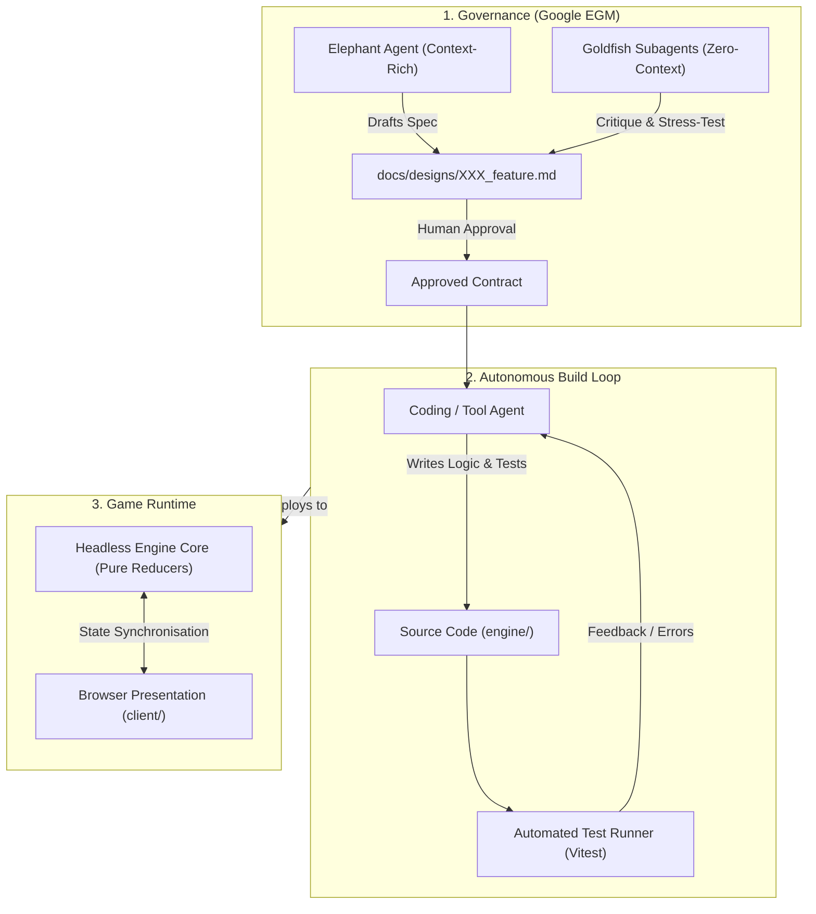

# Concept Brief: emergent

**Document State:** Approved Concept Baseline  
**Methodology:** Google EGM (Elephant Phase - Concept Formulation)  
**Author:** Pair programming session (Human & Antigravity)  

---

## 1. Vision & Core Philosophy

`emergent` is a far-future, humanistic browser RPG set upon a remote, isolated frontier world. Centuries after an unremembered cosmic cataclysm or civilisational collapse, human life has reorganised into a semi-feudal society. Baronies, roving pilgrim orders, agrarian villages, and scavenger guilds subsist amidst the weathered, colossal skeletons of incomprehensible mega-structures and orbital wreckage.

The title reflects a dual reality:
* **In-World:** A fragile society emerging from a dark age under the quiet, lingering shadow of an ancient emergency.
* **Architecture:** An episodic sandbox where complex world states, narratives, and mechanics emerge dynamically through deterministic simulation and agentic engineering.

---

## 2. Series Context & Thematic Heritage

The project belongs to an established catalogue of works defined by single-word, lowercase, evocative titles exploring existential human conditions:
* **`hostile`:** Hard sci-fi — thermodynamic reality, cold vacuum, and mechanical danger.
* **`unsettled`:** Folk medieval horror — creeping psychological and ecological dread.
* **`charged`:** Psychedelic — altered perception and electric sensory saturation.
* **`emergent`:** Far-future humanistic fiction — pastoral fragility beneath ancient cosmic ruin.

---

## 3. Thematic Etymology: Why `emergent`?

The chosen title bridges the in-world fiction and software architecture across five interconnected layers:

1. **The In-World Epoch:** Humanity emerging from the long silence of a dark age to rebuild culture, lineage, and craft amidst ancient ruins.
2. **The "Emergent" Canopy (Ecology):** In forestry, "emergents" are the giant ancient trees punching through the rainforest canopy—mirroring the titanic spires puncturing the pastoral horizon.
3. **Complexity & Simulation:** In systems science, *emergent* behaviour arises unscripted from simple local rules—the exact philosophy of a sandbox driven by discrete tick reducers.
4. **Episodic & Agentic Development:** The game is not built from a monolithic static design document; it emerges feature-by-feature through Google EGM cycles.
5. **The Subconscious Echo of "Emergency":** Derived from the Latin *emergere* ("to rise out of depth"), it shares its root with *emergency* (originally an unexpected occurrence, later an acute crisis). This injects an underlying note of tension and precarious survival, matching the atmospheric profile of its sibling titles.

---

## 4. Setting & Aesthetic Pillars

* **Deep Time & Secular Relics:** Technology from prior epochs is not magical fantasy; it is incomprehensibly advanced physics, material science, and orbital automation worn down by eons of dust, rain, and salvage.
* **Humanistic Feudalism:** Society is local, fragile, and grounded. People care about crop yields, water rights, oaths of fealty, trade caravans, and family lineage, all unfolding in the literal shadow of derelict star-docks and dead orbital spires.
* **The "Emergent" Canopy:** Like towering ancient trunks, solitary gargantuan ruins punctuate the pastoral horizon.
* **Narrative Sovereignty:** AI agents never invent major world lore, factions, or premises autonomously. All worldbuilding originates from the human developer via asynchronous authoring canvases (`docs/lore/open_questions.md`).

---

## 5. Core Gameplay Loop (Target Blueprint)

1. **Exploration & Traverse:** Navigating an unmapped, episodic world grid composed of settlements, ruins, wilderness, and contested fiefs.
2. **Systemic Simulation:** Time advances in discrete ticks governed by the authoritative headless engine (`engine/`). Weather, resource scarcity, faction standing, and entity schedules operate deterministically.
3. **Dialogue & Human Drama:** Multi-perspective interactions with local lords, pilgrims, and scavengers, balancing personal oaths with faction pressures.
4. **Relic Salvage & Risk:** Venturing into unsealed sub-structures where ancient automated systems may still be active, unstable, or malfunctioning.

---

## 6. Technical & Reference Architecture

* **Design Governance:** Google EGM (Elephant-Goldfish Model). No code is committed to features without approved specifications in `docs/designs/`.
* **Engine Core (`engine/`):** Authoritative, headless discrete-tick simulation implementing pure reducer state mutations.
* **Browser Client (`client/`):** Lightweight WebGL/Canvas renderer coupled via an event/state synchronisation stream.
* **Continuous Verification:** One-command headless verification runners executing typechecking and unit test suites before any git checkpoint.
