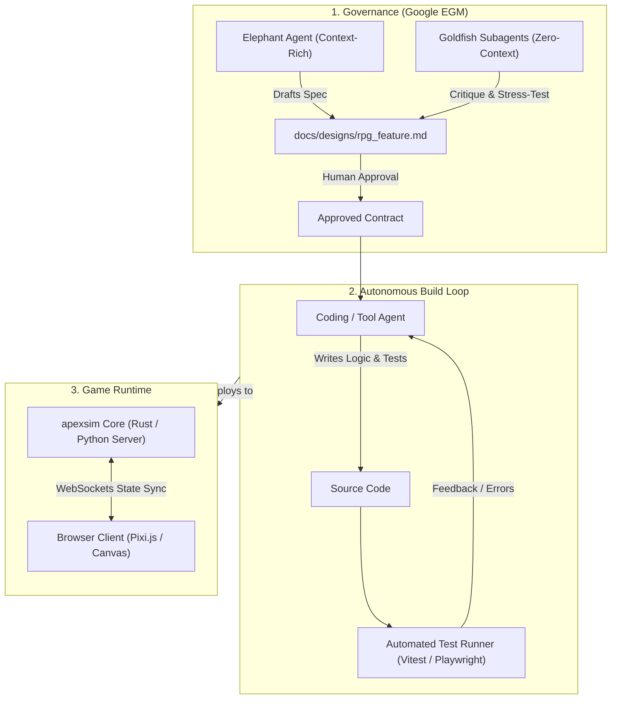

# Conversation Export: Autonomous RPG Development with Google EGM & apexsim

**Date:** 31 October 2026  
**Topic:** Architectural assessment and project structure for combining Google EGM (Elephant-Goldfish Model) and Guido's `apexsim` framework for autonomous browser RPG game development.

---

## User Prompt

> I want to setup a project to experiment with the combination of Google EGM for design and Guido's apexsim framework. Would those two be enough to autonomously drive the development of a complex project? Something like an RPG browser game?

---

## Architectural Evaluation & Response

### Executive Summary

**No, Google EGM and Guido's `apexsim` framework alone are not sufficient to autonomously drive the development of a complex project like a browser RPG.**

However, they form two indispensable pillars of a viable architecture:
* **Google EGM** provides architectural governance and the specification engine.
* **`apexsim`** provides the authoritative state simulation core.

To achieve end-to-end autonomous or semi-autonomous development, additional execution, presentation, testing, and feedback layers must be integrated.

---

### 1. Understanding the Roles: EGM vs apexsim

#### Google EGM (Elephant-Goldfish Model)

Google EGM is a **Spec-Driven Development (SDD)** paradigm designed to eliminate AI hallucination, context drift, and premature implementation:
* **The Elephant (Deep Context):** A persistent, high-context agent that holds the end-to-end vision, interviews the developer about mechanics, and drafts specifications (`concepts_brief.md`, `docs/designs/*.md`). It strictly observes a **no-code** rule during design phases.
* **The Goldfish (Zero Context):** Swarms of stateless, isolated subagents that review drafted specifications with a completely blank slate, actively probing for edge cases, scaling bottlenecks, and unstated assumptions.
* **What it does:** Guarantees that you have airtight, self-contained technical specifications before a single line of code is written.
* **What it does not do:** EGM is not an implementation engine; it does not write application code, execute build systems, or inspect game canvases.

#### Guido's `apexsim` Framework

Whether utilizing Guido Docter's authoritative 240Hz physics/simulation server or a tick-based engine framework:
* **What it does:** Acts as the **runtime simulation backbone**. It manages deterministic tick loops, coordinate updates, collision calculations, and state synchronisation.
* **What it does not do:** It has no agency. It cannot write its own features, design quests, generate browser UI, or debug failed builds.

---

### 2. The Missing Pillars (Gaps to Autonomy)

To autonomously take an RPG browser game from concept to working software, five distinct layers are required:

```
[ 1. Design & Governance ]  --> Google EGM (Elephant & Goldfish)
[ 2. Autonomous Coder    ]  --> MISSING (Execution & Tool-Use Agent)
[ 3. Continuous Testing  ]  --> MISSING (Headless Browser & TDD Loop)
[ 4. Simulation Engine   ]  --> Guido's apexsim (State & Tick Loop)
[ 5. Presentation Layer  ]  --> MISSING (DOM/Canvas, WebGL, Assets, Audio)
```

#### Gap 1: The Autonomous Implementation Agent (The Builder)

EGM explicitly halts at the design phase. To autonomously write code from approved specifications, an **orchestrated coding loop** is required with file-editing tools, AST manipulation, and shell execution (such as Antigravity, Claude Code, or an autonomous SWE agent loop). The agent must consume EGM specs as strict, binding contracts.

#### Gap 2: The Automated Verification & Perception Loop

An AI agent cannot determine whether an RPG browser game is operating correctly without an automated perception and evaluation harness:
* **Headless Browser Automation:** Tools like **Playwright** or **Puppeteer** to render the game, simulate keystrokes/clicks, and assert DOM/Canvas state.
* **Tick-Deterministic Unit Tests:** Verification that character stats, inventory mutations, and combat calculations adhere strictly to the EGM design document.
* Without automated testing, an autonomous coding agent will quickly degrade into circular bug-fixing cycles ("context pollution").

#### Gap 3: The Browser Presentation & Asset Pipeline

`apexsim` handles the mathematical model of the world (e.g., player coordinates, inventory arrays, velocity, combat ticks). It does not provide:
* **Rendering Engine:** WebGL / Canvas rendering (e.g., Pixi.js, Phaser, or Three.js).
* **Game Assets:** Spritesheets, tilemaps, animations, sound effects, and user interfaces (health bars, dialogue modals, inventory grids).
* **Network Adapter:** WebSockets or WebRTC to bridge the `apexsim` server state to the browser client.

#### Gap 4: Playability and "Game Feel" (Human-in-the-Loop)

Unlike standard business applications, games succeed or fail based on qualitative metrics: balance, pacing, responsiveness, and fun. Autonomous agents can verify that an attack button decreases enemy health, but they cannot evaluate whether combat feels satisfying. Human sign-off at EGM's `/egm-resolve` milestone remains essential.

---

### 3. Recommended Reference Architecture



---

### 4. Practical Project Setup Blueprint

Recommended directory structure for an experimental project:

```text
rpg-egm-apexsim/
├── docs/
│   ├── concepts/              # EGM concept briefs (concepts_brief.md)
│   ├── designs/               # Living EGM design specifications
│   └── reviews/               # Goldfish critique reports
├── engine/                    # apexsim simulation logic
│   ├── src/
│   │   ├── state/             # World, entity, and inventory state
│   │   ├── systems/           # Combat, movement, quest rules
│   │   └── tick.rs (or .py)   # Authoritative simulation loop
│   └── tests/                 # Deterministic simulation tests
├── client/                    # Browser frontend
│   ├── src/
│   │   ├── render/            # PixiJS / 2D Canvas renderer
│   │   ├── ui/                # HTML/DOM dialogue, inventory screens
│   │   └── net/               # WebSocket client for apexsim state
│   └── tests/e2e/             # Playwright headless browser tests
├── scripts/
│   ├── run_egm_cycle.sh       # Harness invoking brainstorm -> review
│   └── verify_implementation.sh # Linter + Unit Tests + Playwright
└── AGENTS.md                  # Instructions constraining coding agents to EGM specs
```

---

### 5. Recommended Implementation Steps

1. **Establish the Specification Baseline:** Run an initial EGM brainstorming session to define the core game loop (e.g., a grid-based turn/tick dungeon crawler with inventory and dialogue).
2. **Implement the Simulation Prototype First:** Implement the `apexsim` state machine purely in headless code without graphics, validated completely by unit tests.
3. **Mount the Client:** Connect a lightweight browser renderer (such as PixiJS or standard HTML5 Canvas) that simply renders the state stream emitted by `apexsim`.
